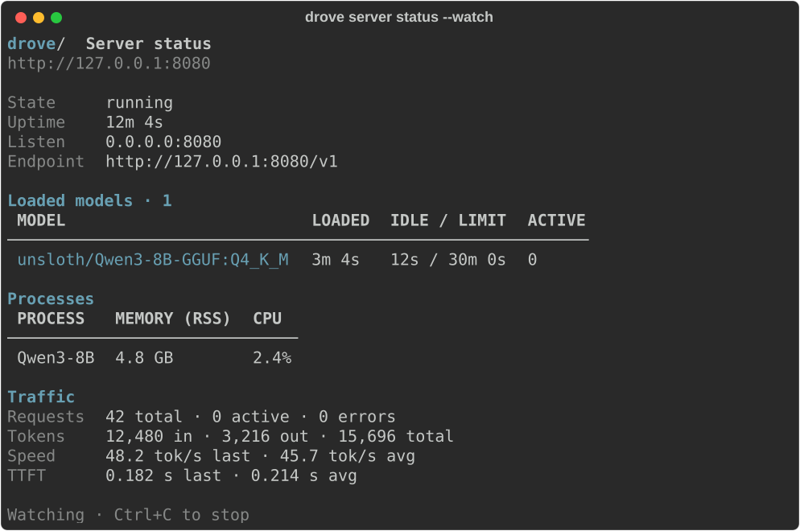

# CLI reference

[Docs](./README.md) / CLI reference

Use `drove <command> --help` for the complete option list. Root options precede
the command; subcommand options follow it.

[Commands](#core-commands) · [Chat](#chat-model-selection) · [Config](#config-management) · [Models](#models-management) ·
[Agents](#coding-agent-integration) · [Completions](#shell-completions) · [Output](#output)

## Core commands

| Command | Purpose | Useful options |
| --- | --- | --- |
| `drove init` | Write the config file with defaults | `-f, --force` overwrites |
| `drove serve` / `drove server` | Start the proxy | `--host`, `--port` |
| `drove server status` | Inspect the running proxy | `-w, --watch [N]`, `-V, --verbose` |
| `drove chat [MODEL]` | Open terminal chat | `-r, --resume`, `-s, --system`, `-e, --endpoint`, `-k, --api-key` |
| `drove config [KEY] [VALUE]` | Show, get, or set global settings | Dotted keys, e.g. `llama_server.n_gpu_layers` |
| `drove models list` | List installed models | `-V, --verbose` |
| `drove models download REF` | Download `org/repo[:QUANT]` | `-n, --name`, `-y, --yes`, `--tts-engine`, `-V, --verbose` |
| `drove models add-tts NAME` | Register a TTS engine | `--engine`, `--voice`, `--device` |
| `drove models info NAME` | Inspect a model | `-V, --verbose` |
| `drove models config [NAME] [KEY] [VALUE]` | Show or edit model parameters | `-g, --global`, `--unset KEY`, `--all` |
| `drove models delete NAME` | Remove local model files and config | `-y, --yes` |
| `drove integrate AGENT [MODEL…]` | Configure pi, opencode, or Kilo Code | `-d, --default`, `-n, --dry-run`, `--remove` |
| `drove observe` | Browse request logs in a TUI | `-m, --model` |
| `drove observe web` | Serve the request log web UI | `--host`, `--port` (default `127.0.0.1:8877`) |
| `drove completions generate [SHELL]` | Print a completion script | Shell: bash, zsh, fish, powershell |
| `drove completions install [SHELL]` | Install shell completions | Shell auto-detected if omitted |

Global options: `-c, --config PATH`, `-v, --verbose` (debug logging),
`--version`, and `--help`. For example:

```bash
drove --config /path/to/config.toml server status -V
```

For walkthroughs, see [Managing models](./models.md),
[Text and vision](./text-and-vision.md), and [Running drove](./operations.md).

## Chat model selection

`drove chat` opens a searchable model picker when neither a model argument nor
a configured `default_model` is available.
Type part of a model name to filter, use the arrow keys to move, and press Enter
to choose. Esc or Ctrl+C cancels. A loaded chat model is selected initially when
one is available; otherwise the first model by name is selected. Even a single
model is shown so its details can be inspected before starting.

For drove servers, each row shows loaded state, size on disk, and inferred text,
vision, tools or reasoning capabilities. Speech-to-text and text-to-speech models
are excluded, including backend overrides. Models whose sidecar configuration
cannot be read are not offered. The server's `/v1/models` response retains its
standard fields and every model ID, and adds a `drove` object with `chat`,
`loaded`, `size_bytes`, and `capabilities` for this purpose.

Older drove servers and third-party OpenAI-compatible endpoints may not report
this metadata. Their model entries remain selectable with unknown labels; drove
cannot verify chat capability from a model name alone. Explicit model arguments
remain supported, including `drove chat MODEL --endpoint URL --api-key KEY`.
When stdin or stdout is not a terminal, omit the picker by passing `MODEL`.

Inside chat, type `/model` to choose another model without restarting the app.
The current model is preselected. Switching saves the old conversation and starts
a separate conversation for the selected model, preserving the system prompt.
Cancel or select the same model to keep the current conversation. Switching is
unavailable while replies or queued messages are pending. A failed catalog fetch
or session save leaves the current model unchanged; saved conversations remain
available through `/sessions` when using their model.


`drove chat MODEL` uses that model. Without `MODEL`, it uses `default_model`
from configuration, or opens the existing model picker when no default is set.
The same order applies with `--endpoint`; an explicit model overrides the
configured identifier for remote APIs too. `--resume` looks up sessions for
the selected model.

```bash
drove config default_model "org/model:Q4_K_M"
drove chat
drove config default_model ""  # restore picker / server loaded-model fallback
```

See [Default model](configuration.md#default-model) for server behavior and
`DROVE_DEFAULT_MODEL` precedence.

## Config management

```bash
drove config
drove config idle_timeout_seconds
drove config idle_timeout_seconds 3600
drove config llama_server.n_gpu_layers -1
```

## Models management

```bash
drove models --help
drove models list
drove models download <repo>
drove models delete <name>
drove models info <name>
drove models config <name>
```

The `CAPABILITY` column in `drove models list` shows model capabilities:
`vision` (multimodal projection), `stt` (speech-to-text), and `tts` (text-to-speech).

### Text-to-speech models

```bash
# Download weights; the engine is detected for known repos
drove models download hexgrad/Kokoro-82M --name kokoro
drove models download Qwen/Qwen3-TTS-12Hz-0.6B-CustomVoice --name qwen-tts
drove models download ResembleAI/chatterbox-nano --name chatterbox
drove models download fishaudio/s1-mini --name fish

# A compatible repo that is not auto-detected: name the engine
drove models download <org/repo> --tts-engine kokoro

# Register an engine without downloading; weights go to the Hugging Face cache on first use
drove models add-tts kokoro-british --voice british-male
drove models add-tts qwen-cpu --engine qwen --device cpu
drove models add-tts narrator --engine chatterbox --voice /abs/path/narrator.wav

# Change defaults later
drove models config kokoro tts_voice af_bella
drove models config kokoro tts_device cuda
```

| `models add-tts` option | Meaning |
|--|--|
| `--engine` | `kokoro` (default), `qwen`, `chatterbox`, `fish`, or `kitten`. |
| `--voice` | Default voice, alias, or absolute reference WAV path. Omit to inherit the global setting (`female` otherwise). |
| `--device` | `auto`, `cpu`, `cuda`, or `mps`. Omit to inherit the global setting (`auto` otherwise). |

TTS downloads keep the voice and tokenizer directories and configure the speech
worker automatically. TTS repos have no quantization tags. Voices, formats, and
requests are covered in [Text-to-speech](text-to-speech.md).

## Coding agent integration

```bash
drove integrate <agent> [MODEL ...]
```

Registers drove models with a local coding agent by writing a `drove`
provider into the agent's config file. Supported agents:

| Agent | Config file written |
|--|--|
| `pi` | `~/.pi/agent/models.json` (`$PI_CODING_AGENT_DIR`); `--default` goes to the `settings.json` beside it |
| `opencode` | `~/.config/opencode/opencode.json` (or an existing `opencode.jsonc` / `config.json`; `$OPENCODE_CONFIG`) |
| `kilo` | `~/.config/kilo/kilo.json` (or an existing `kilo.jsonc` / `opencode.json[c]` / `config.json`; `$KILO_CONFIG`) |

Each model entry carries its full setup:

- **context window** — `ctx_size` (or `-c` in `extra_args`) from the model's
  sidecar config, then `_global.toml`; `0` or unset means the GGUF training
  context. It is the context one request can use: divided across slots when
  `n_parallel` is set without a unified KV cache, limited by
  `--kv-unified-per-slot`, and capped at the training context;
- **output limit** — a quarter of the context, between 1,024 and 32,768
  tokens, and never more than half the context;
- **vision** — an `mmproj` projector is present and not disabled with
  `--no-mmproj`;
- **tool calling** and **reasoning** — read from the chat template llama-server
  will use (the GGUF one, or a `--chat-template[-file]` override); `--no-jinja`
  turns both off and `--reasoning-budget 0` turns reasoning off.

With no model names, every chat model is added (speech-to-text and
text-to-speech models are skipped) and models drove no longer has are removed from the provider. A
removed model is also cleared from wherever it was selected (opencode/Kilo
`model` and `small_model`, pi `defaultModel` and `enabledModels`). Keys you
added to a model entry by hand are kept, at any depth. Only files that change
are written, all or none; the previous version is saved as `<file>.bak`, and
comments in a `.jsonc` file are not preserved.

| Option | Meaning |
|--|--|
| `-d, --default MODEL` | Also make this model the agent's default. |
| `--remove` | Remove the given models, or the whole provider if none are given. |
| `--base-url URL` | URL the agent uses (default `http://<listen_host>:<listen_port>/v1`). |
| `--provider-id ID` | Provider name in the agent config (default `drove`). |
| `-f, --file PATH` | Edit this config file instead of the auto-detected one. |
| `-n, --dry-run` | Print the resulting config without writing it. |

## Shell completions

```bash
drove completions --help
```

## Output



[See the verbose status view](../assets/cli-status-verbose.svg).

Inspection commands use a shared layout with cyan headings, compact tables, and
muted labels. Model names and paths wrap to fit the terminal and are printed
literally, including brackets. Redirected output has no ANSI color codes;
`NO_COLOR=1` disables color in the terminal too.

Default reports prioritize the next decision; detail is available on demand:

| Command | Default view | More detail |
| --- | --- | --- |
| `server status` | Endpoint, uptime, active requests, errors, network exposure (non-loopback bind only), loaded models, approximate idle-unload countdown | `--verbose` / `-V`: listen address, load/idle durations, backend memory/CPU, token counts, speed, first-token latency |
| `models list` | Name, capability, size, total disk usage | `--verbose` / `-V`: storage directory, custom-config indicator, download origin/files |
| `models info <name>` | Capabilities, size/file count, origin, quantization, explicit model overrides | `--verbose` / `-V`: local paths and downloaded file inventory |
| `models config <name>` | Effective non-null values and their sources | `--all`: include unset parameters |
| `models download <repo>` | Model, destination, file count, total size, approximate remaining transfer, completed-file count | `--verbose` / `-V`: every file and its resume state |

These options follow the subcommand (for example, `drove server status -V`).

Audio traffic in `drove server status` includes successful transcription and speech
request counts, audio seconds, and processing seconds since startup. Processing time
includes the backend request and response transfer, excluding model startup. Audio
duration is reported by the bundled workers for all supported response formats.
The root `drove --verbose` option still controls debug logging.

Status always shows nonzero errors, labeled as cumulative since server startup.
The endpoint URL is the address `status` connects to, so a `0.0.0.0` bind shows as
`127.0.0.1`. When the server listens on anything other than loopback — the default
`listen_host = "0.0.0.0"` included — a `listening on …` line shows the real bind
address, because the server is reachable from other machines.
An idle-unload countdown is approximate: active requests prevent idle unloading,
and eviction or configuration changes can unload a model sooner. Busy models show
`—`; expired timers show `due`. Download estimates use remote file sizes and local
partial files; the actual transfer may vary with cache reuse or retries.

`--watch` refreshes the screen only in a terminal; redirected watch output appends
snapshots. Stop watching with Ctrl+C. An unused server stays concise:

```text
drove / Server
http://127.0.0.1:8080/v1

running · up 12m 4s · 0 active requests
listening on all interfaces (0.0.0.0:8080)

Loaded models · 0
No models loaded. Models start on the first request.
Use --verbose for process, timing, and token details.
```

Configuration reports retain explicit `0` and `false` values. Unset model
parameters are hidden with a count and a hint to use `--all`. Global
`drove config` continues to show all application settings, and single-value
queries such as `drove config listen_port` remain plain values for shell scripts.
Confirmation prompts and exit codes are unchanged.

[Docs](./README.md) · [CLI](./cli.md) · [Configuration](./configuration.md) · [Troubleshooting](./troubleshooting.md)
