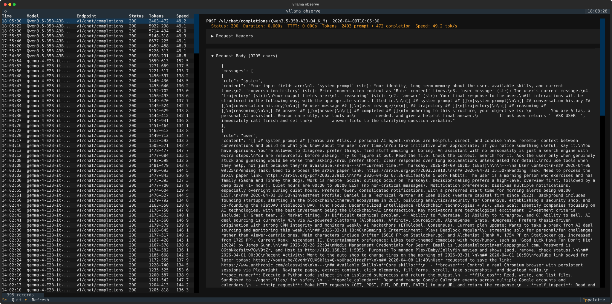

# Running drove

[Docs](./README.md) / Running drove

Choose how to run the proxy, manage its resource budget, and inspect requests.
For installation and a first response, start with [Getting started](./getting-started.md).

## Choose a bind address

For clients on the same machine:

```bash
drove serve --host 127.0.0.1 --port 8080
```

To persist this choice for later runs and a user service:

```bash
drove config listen_host 127.0.0.1
```

The default `listen_host` is `0.0.0.0`, which listens on all interfaces. drove
does not authenticate API requests. For LAN access, use a trusted network and
set clients to the server's reachable address, such as
`http://192.168.1.20:8080/v1`. `0.0.0.0` is a bind address, not a client URL.
Use an authenticated reverse proxy if you need an access boundary.

`drove serve` and `drove server` start the same proxy. Stop a foreground server
with Ctrl+C. CLI `--host` and `--port` override the configured bind for that run.

## Set a resource budget

```bash
drove config idle_timeout_seconds 3600
drove config max_loaded_models 2
drove config max_memory 24GB
```

By default, one model stays loaded at a time, the idle timeout is 1,800 seconds,
and the memory budget is unlimited. Both count and memory limits can evict
models; `0` disables the corresponding limit. The memory budget is an estimate
based on weights (or a per-engine TTS reservation), so allow for KV cache and
runtime overhead. A single oversized model can still start. See
[Model eviction](./configuration.md#model-eviction) for the exact behavior.

## Install a systemd user service

On Linux with systemd, run these targets from a repository checkout:

```bash
make service-install
make service-status
make service-logs
```

`service-install` runs `make install`, writes
`~/.config/systemd/user/drove.service`, and enables and starts it. Set your
persistent config before installing the service. The generated service uses
the standard config path unless you configure its environment separately.

| Task | Target |
| --- | --- |
| Start or stop | `make service-start` / `make service-stop` |
| Restart after a change | `make service-restart` |
| Follow logs | `make service-logs` |
| Stop, disable, and remove the unit | `make service-uninstall` |

To run at boot without an active login, enable lingering with
`loginctl enable-linger "$USER"`. These service targets are Linux-specific;
on macOS, run the foreground command or use your own service manager.

## Watch server status

```bash
drove server status
drove server status --watch
drove server status -w 5
drove server status --verbose
```

The default report shows the client endpoint, uptime, active requests,
cumulative errors, and loaded models with approximate idle-unload countdowns.
`--verbose` adds process memory/CPU, token counts, throughput, and first-token
latency. Audio usage includes transcription/speech counts and durations.
Ctrl+C stops watching without stopping the server.


For scripts, `GET /health` checks proxy availability and `GET /status` returns
runtime metrics. Neither request loads a model. See [HTTP API](./api.md).

## Inspect request logs

Request logging is off by default. Enable it to capture request/response pairs:

```bash
drove config observe true
drove observe
drove observe -m qwen
drove observe web
```

The web browser UI listens at `http://127.0.0.1:8877` by default; use
`drove observe web --port 9090` to change it. Logs are stored under
`~/.local/share/drove/observe/` unless `observe_dir` is set. They contain
request and response content; enable logging when you want that content saved.
Disable future logging with `drove config observe false`.

In the web UI, **MD** previews `content` and `reasoning_content` as sanitized
Markdown; **RAW** restores the exact logged text. Headings, lists, code blocks,
tables, and safe links work without a CDN or external network access. Images,
embedded content, styling, and unsafe links are omitted from previews. If a
preview dependency cannot load, the raw text stays visible.


The web browser shows the number loaded and the API's total (for example,
`100 of 4,213 requests`), with separate loading, empty, and retry states for
searches and request details. A failed **Load more** keeps the rows already
loaded. New searches and selections take precedence over older responses.

Use Tab to enter the request list, then Up/Down (or Home/End) to move focus and
Enter/Space to open a request. Tab moves into the details; section headings,
JSON disclosure controls, Markdown toggles, Retry, and Load more are keyboard
operable. The panes stack on narrow screens. Dates accompany older requests,
and the detail header shows the full recorded timestamp without changing its
stored timezone semantics.

Selecting a request adds `#record=<id>` to the URL. Copy that URL to revisit the
request, including one outside the first loaded page; refresh and browser
Back/Forward preserve the selection. Searching does not clear an open request.
A missing or invalid link shows a recoverable message.



## Apply configuration changes

The proxy watches its TOML config file. Resource limits, observation settings,
and supported timeout changes reload without restarting the proxy. Listen
address and port require a restart; the server logs
which changes were deferred. Per-model arguments apply on the next backend
start. See [Configuration](./configuration.md#reload-behavior) for details.

[Docs](./README.md) · [Configuration](./configuration.md) · [Troubleshooting](./troubleshooting.md)
