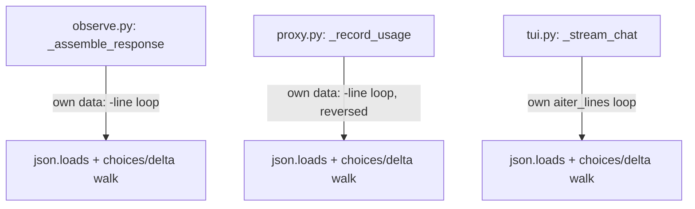
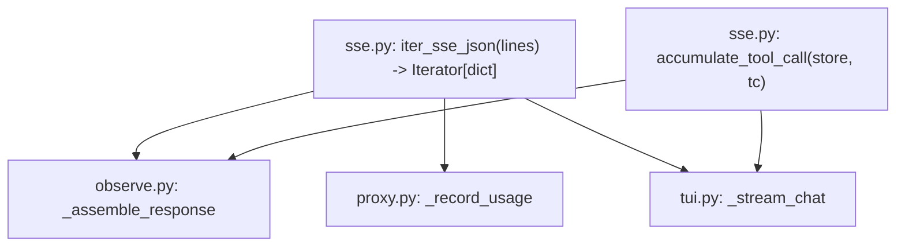

# 🏗️ Architect proposal: extract a shared SSE-delta parser out of `observe.py`, `proxy.py`, and `tui.py`

**Status:** proposed, no code changes included
**Author:** Architect (automated structural-debt review)
**Date:** 2026-09-28

## One-sentence proposal

Move the OpenAI-style `data: {...}` SSE-line parsing and delta/tool-call accumulation logic —
currently reimplemented independently in `observe.py`, `proxy.py`, and `tui.py` — into one shared
module, `src/drove/sse.py`.

## Why now

Three modules each parse llama-server's streaming chat-completions format from scratch:

- `observe.py::_assemble_response` (lines 48–124) — splits `raw` on `\n`, filters `data: ` lines,
  skips `data: [DONE]`, `json.loads`s the payload, walks `choices[].delta` for `content` /
  `reasoning_content` / `tool_calls`, and accumulates tool-call fragments in a
  `dict[int, dict[str, str]]` keyed by index — to build the human-readable observe-log entry.
- `proxy.py::_record_usage` (lines 452–498) — the same `data: ` filter/skip/`json.loads` loop
  (scanned backwards), extracting `usage`/`timings` instead of content — to record per-request
  token metrics.
- `tui.py::_stream_chat` (lines 832–885) — the same filter/skip/`json.loads` shape again, this
  time over `httpx`'s async `aiter_lines()`, extracting content/reasoning/tool-calls — to drive the
  live chat TUI, including its own second `dict[int, dict[str, str]]` tool-call accumulator
  (duplicating the one in `observe.py`).

Three independent reimplementations of "how to read an SSE chat-completions stream" is the
"code duplication across modules" pattern this review is meant to catch. It already causes
asymmetric coverage: `proxy.py`'s `_record_usage`/`_extract_tokens_from_obj` has **no dedicated
tests** in `tests/test_proxy.py` — it's only reachable indirectly through full proxy
integration tests — while `observe.py`'s equivalent logic is tested directly in
`tests/test_observe.py`. There's no single seam to unit-test "parse one SSE delta line" once,
so each site's edge-case handling (a multi-`choices` response, a malformed line, a differently
cased `data:` prefix) has drifted slightly out of sync already: `proxy.py` and `observe.py`
require a space after `data:` (`"data: "`) while `tui.py` accepts `"data:"` with no space
(`line[5:].strip()`).

If llama-server's streaming format ever adds a field (or drove adds a second OpenAI-compatible
backend), that change needs to be threaded through three places by hand, with three chances to
miss one.

## Current architecture



Each of `J1`/`J2`/`J3` re-derives the same shape (skip non-`data:` lines, skip `[DONE]`,
`json.loads`, walk `obj["choices"][i]["delta"]`) with slightly different edge-case handling.

## Proposed architecture



`src/drove/sse.py` grows two small, synchronous, dependency-free helpers:

```python
def iter_sse_json(lines: Iterable[str]) -> Iterator[dict[str, Any]]:
    """Yield parsed JSON objects from `data: {...}` SSE lines; skips [DONE] and bad lines."""
    for line in lines:
        stripped = line.strip()
        if not stripped.startswith("data:"):
            continue
        payload = stripped.removeprefix("data:").strip()
        if payload == "[DONE]":
            continue
        try:
            obj = json.loads(payload)
        except json.JSONDecodeError, ValueError:
            continue
        if isinstance(obj, dict):
            yield obj


def accumulate_tool_call(store: dict[int, dict[str, str]], tc: dict[str, Any]) -> None:
    """Merge one streamed tool_call delta fragment into `store`, keyed by its index."""
    idx = tc.get("index", 0)
    entry = store.setdefault(idx, {"id": "", "name": "", "arguments": ""})
    if tc.get("id"):
        entry["id"] = tc["id"]
    func = tc.get("function", {})
    if func.get("name"):
        entry["name"] = func["name"]
    if func.get("arguments"):
        entry["arguments"] += func["arguments"]
```

`iter_sse_json` is a plain generator over any `Iterable[str]`, so it drops into all three call
sites unchanged: `raw.splitlines()` (`observe.py`), `reversed(text.splitlines())` (`proxy.py`),
and — since `tui.py` already awaits `httpx`'s async line iterator one line at a time before
doing anything else with it — a one-line-at-a-time call inside its existing `async for line in
resp.aiter_lines()` loop (no async generator needed; only the per-line parse step moves, not the
iteration itself). This also settles the `"data: "` vs `"data:"` drift in `tui.py` in favor of
the more lenient form used today (`removeprefix` handles both).

## Scope

This is the *only* change proposed. It does **not**:
- change the observe-record schema, the `/v1/*` proxy contract, or the chat TUI's rendering
- touch `usage`/`timings` extraction semantics in `_extract_tokens_from_obj` (stays in
  `proxy.py`, calling into `iter_sse_json` for the line-parsing step only)
- add a shared *async* SSE abstraction — `tui.py` keeps its own `httpx` streaming loop, only the
  per-line JSON-decode step is shared
- touch model config, CLI, or any other proposal currently outstanding (the
  2026-08-24 backend-adapter proposal is unrelated and unaffected by this one)

## Migration plan (backward-compatible, single stage)

1. Add `src/drove/sse.py` with `iter_sse_json` and `accumulate_tool_call`, plus direct unit
   tests in a new `tests/test_sse.py` (malformed line, missing space after `data:`, `[DONE]`
   sentinel, multi-`choices` object, non-dict JSON payload).
2. `observe.py::_assemble_response`: replace its inline `for line in raw.splitlines(): ...`
   block with `for obj in iter_sse_json(raw.splitlines()): ...` and its inline tool-call
   accumulation with `accumulate_tool_call(tool_calls, tc)`.
3. `proxy.py::_record_usage`: replace its inline backwards-scanning loop with
   `for obj in iter_sse_json(reversed(text.splitlines())): ...`, keeping the existing
   "stop at the first line with completion tokens" early-exit.
4. `tui.py::_stream_chat`: inside the existing `async for line in resp.aiter_lines():` loop,
   replace the inline `if not line.startswith("data:") / json.loads(...)` block with a call to
   a line-level helper extracted from `iter_sse_json` (or by wrapping the single line in a
   one-element list — either is a few lines), and its tool-call accumulation with
   `accumulate_tool_call`.
5. Delete the now-dead inline parsing code at each of the three sites.

No dual-write and no feature flag: every moved block keeps its current external behavior (same
return values, same yielded event shape), so this ships in one PR and reverts cleanly with
`git revert` if anything regresses.

## Performance impact

Negligible to slightly positive. This is a pure code-motion refactor — the same number of
`json.loads` calls happen in the same order. `tui.py` gains a one-time `removeprefix`/`strip`
instead of a fixed `line[5:]` slice, which is not measurably different at chat-token
frequency (tens of lines/sec, not the request hot path `proxy.py` already streams through the
process boundary).

## Risk level: **low**

- No API, schema, or CLI contract changes — pure internal refactor.
- No new runtime dependencies.
- Each of the three call sites already has behavioral test coverage today except `proxy.py`'s
  `_record_usage`, which this proposal adds direct coverage for as a side effect (via the new
  `tests/test_sse.py`, plus existing integration coverage in `test_proxy.py` continuing to pass
  unchanged).
- Fully reversible in one commit; `tui.py` (currently untested — no `tests/test_tui.py` exists)
  is the highest-touch site, but the change there is a small, mechanical substitution inside an
  existing loop, not a rewrite of `_stream_chat`'s control flow.

## Test strategy

- New `tests/test_sse.py`: unit-test `iter_sse_json` directly — valid delta, `data:` with and
  without a trailing space, `[DONE]` sentinel, malformed JSON, non-dict JSON, multiple `data:`
  lines in one stream — and `accumulate_tool_call` — fresh index, repeated index (arguments
  concatenate), out-of-order id/name arrival.
- `tests/test_observe.py`: existing `_assemble_response` tests continue to pass unchanged
  (behavior-preserving refactor); add one case for a `data:`-without-space line, which today
  would silently fail to parse in `observe.py` but will parse after this change — call out the
  now-shared leniency explicitly in that test.
- `tests/test_proxy.py`: add the direct `_record_usage`/`_extract_tokens_from_obj` unit tests
  that don't exist today, now straightforward since the line-parsing step is a tested primitive.
- No new integration/e2e tests needed for `tui.py` — manual smoke-check (`drove chat`) of a
  streamed response with a tool call remains the verification step for that site, consistent
  with the rest of the TUI being manually verified today.

## Who must approve

Single-maintainer repo (`cleanunicorn/drove`) — repo owner sign-off is sufficient. No
infra/security review needed (no data, auth, or network-boundary changes; `sse.py` parses
already-trusted local backend output, not external input).

## Non-goals / explicitly deferred

- Making `tui.py`'s streaming loop share an async generator with `proxy.py`/`observe.py` — those
  two are synchronous (operating on an already-fully-read `bytes`/`str` body), `tui.py` is
  incrementally async; unifying that would be a bigger, separate change with unclear payoff.
- Adding `tests/test_tui.py` more broadly — real, but a separate, larger effort (904 lines, zero
  existing coverage) out of scope for this refactor.
- Changing `_extract_tokens_from_obj`'s usage/timings precedence rules — unrelated to the
  parsing-duplication problem this proposal addresses.
